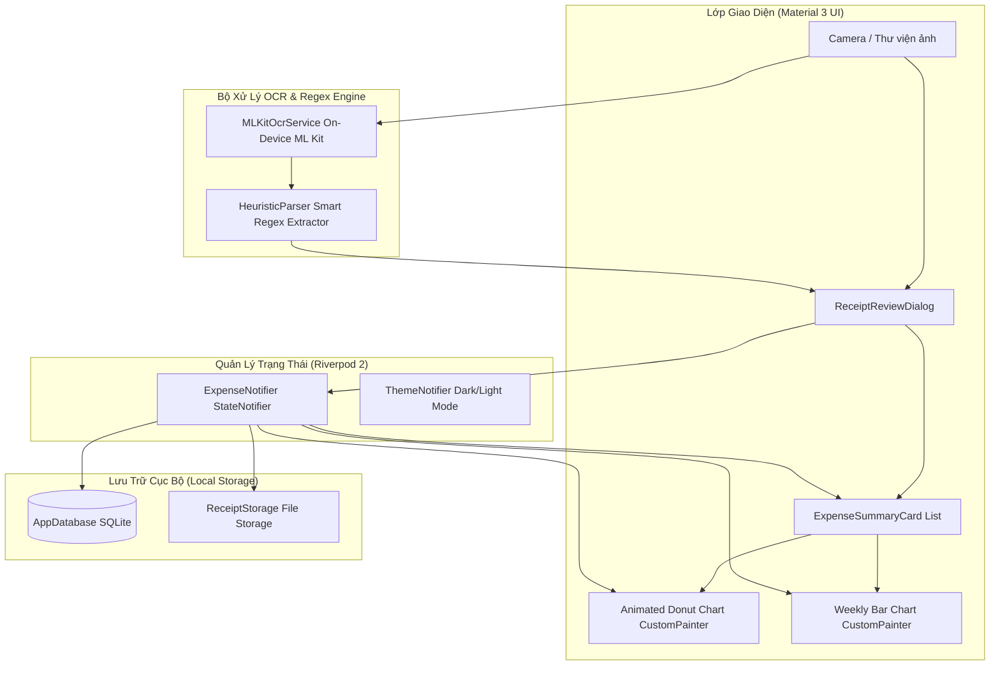

# 🧾 VKU Expense OCR — Smart On-Device Receipt & Expense Tracker

<p align="center">
  
  
  
  
  
  
  
</p>

---

## 📌 Giới Thiệu Dự Án (Project Overview)

**VKU Expense OCR** là ứng dụng di động quản lý chi tiêu và quét hóa đơn thông minh trên nền tảng **Flutter & Dart 3**, được phát triển theo tiêu chuẩn đồ án **Mini-Project 3 (Cross-Platform Mobile App Development - Đại học Công nghệ Thông tin và Truyền thông Việt - Hàn, VKU)**.

### 🎯 Bài toán thực tế (Scenario - Slide 41)
Sinh viên và các ban chủ nhiệm câu lạc bộ tại VKU thường xuyên phải xử lý nhiều hóa đơn tiền mặt lẻ (ăn uống, mua sắm vật tư, xăng xe, liên hoan...). Việc nhập thủ công từng con số vào bảng tính Excel rất tốn thời gian và dễ nhầm lẫn. 

**VKU Expense OCR** giải quyết triệt để vấn đề này với quy trình tự động hóa khép kín:
1. **Chụp / Chọn ảnh hóa đơn** từ máy ảnh hoặc thư viện ảnh.
2. **Nhận diện chữ On-Device (Offline)** bằng Google ML Kit — bảo mật tuyệt đối, không gửi ảnh lên máy chủ, không phụ thuộc kết nối Internet.
3. **Bộ bóc tách thông minh Heuristic Regex** tự động trích xuất: Tên cửa hàng, Ngày chi tiêu, Tổng tiền thanh toán và Tự động gợi ý danh mục chi tiêu.
4. **Hộp thoại Review & Edit** cho phép người dùng xác nhận và tinh chỉnh dữ liệu trước khi lưu trữ.
5. **Lưu trữ SQLite cục bộ bền vững** kèm ảnh chụp hóa đơn gốc.
6. **Trực quan hóa tài chính bằng biểu đồ Canvas tự vẽ** (`CustomPainter`), hiển thị phân bổ chi tiêu và chi tiêu 7 ngày gần nhất.

---

## 🏗️ Kiến Trúc Hệ Thống (System Architecture)

Dự án áp dụng cấu trúc **Feature-First Architecture** kết hợp triết lý **"Everything is a Widget"** và mô hình **3 Trees (Widget Tree $\rightarrow$ Element Tree $\rightarrow$ RenderObject Tree)** của Flutter:



---

## 🌟 Các Tính Năng Trọng Tâm

### 1. 📷 On-Device OCR & Thuật Toán Heuristic Nâng Cao (3.5 pts)
* **100% Offline Google ML Kit**: Sử dụng `google_mlkit_text_recognition`, không phát sinh chi phí API cloud.
* **Xử lý số tiền và khoảng trắng**: Tự động chuẩn hóa các dạng in nhiệt lỗi như `537, 000` $\rightarrow$ `537,000` và `537 . 000` $\rightarrow$ `537.000`.
* **Khử giãn chữ (Letter-Spacing Collapsing)**: Phát hiện chính xác các hóa đơn in giãn dòng/cách chữ như `T  I  E  N   M  A  T` $\rightarrow$ `TIENMAT`.
* **Bộ lọc loại trừ mã số / Metadata (Negative Filtering)**:
  - Loại trừ số thứ tự/mã ca bắt đầu bằng số `0` (ví dụ: `CA 1 MC #01 000887`).
  - Tự động bỏ qua số điện thoại (`DT:`, `HOTLINE:`, `TEL:`), giờ in (`17:50`), mã bàn, mã số thuế.
  - Thiết lập sàn mệnh giá VNĐ: Loại bỏ các số rác $< 1.000$ đ.
* **Lọc nhiễu tiêu đề cửa hàng**: Tự động kiểm tra tỷ lệ ký tự chữ/dấu ($\ge 65\%$) để bỏ qua các dòng rác OCR ở đầu bill, loại bỏ các ký tự lạ (`giŸ Thiết bị...` $\rightarrow$ `Thiết bị...`).
* **Trích xuất ngày tháng đa định dạng**: Nhận diện định dạng ngày chuẩn (`dd/MM/yyyy`), định dạng chữ tiếng Việt (*"Ngày ... tháng ... năm ..."*), định dạng dính số OCR (`2308/2022`), và bóc tách từ mã hóa đơn POS chuẩn (`HDddMMyy-XXXX`).

### 2. 🎨 Trực Quan Hóa Bằng Biểu Đồ Tự Vẽ — Zero 3rd Party Charts (2.5 pts)
* **Animated Donut Chart (`donut_chart_painter.dart`)**: Tự vẽ 100% bằng `CustomPainter` với `canvas.drawArc`, hiệu ứng bung biểu đồ mượt mà theo góc quét, hiển thị tỷ lệ % của từng danh mục.
* **Weekly Bar Chart (`bar_chart_painter.dart`)**: Tự vẽ các cột chi tiêu 7 ngày trong tuần với `canvas.drawRRect`, tự động tính toán tỷ lệ trục Y, vẽ đường gióng lưới ngang (`grid lines`) và nhãn thứ.
* **Không phụ thuộc thư viện đồ họa ngoài**: Đảm bảo hiệu năng vẽ ở tần số quét cao (120Hz Impeller Engine).

### 3. ⚡ Quản Lý Trạng Thái & Lưu Trữ Bền Vững (2.0 pts)
* **Flutter Riverpod 2**: Tổ chức trạng thái tập trung với `StateNotifierProvider`, hỗ trợ tính toán tổng chi tiêu theo tuần/tháng và thống kê phân bổ theo thời gian thực.
* **SQLite Bền Vững (`sqflite`)**: Hỗ trợ đầy đủ CRUD:
  - Thêm mới giao dịch kèm ảnh hóa đơn.
  - Xem danh sách chi tiêu ảo hóa hiệu năng cao (`ListView.builder` + `ValueKey`).
  - Tìm kiếm, lọc theo danh mục.
  - Cập nhật và Xóa giao dịch với thao tác vuốt `Dismissible`.
* **Quản lý File Ảnh (`ReceiptStorage`)**: Lưu trữ ảnh vào thư mục tài liệu an toàn của ứng dụng (`path_provider`), tự động dọn dẹp file ảnh trên ổ đĩa khi giao dịch bị xóa.

### 4. 💎 Thiết Kế UI/UX Polish & Bài Tập Lab Slide 45 (1.0 pt)
* **Material Design 3 Foundation**: Sử dụng bảng màu động với Seed Color **VKU Navy** (`#2C4570`) chuẩn nhận diện trường.
* **Dark / Light Mode**: Chuyển đổi giao diện sáng/tối linh hoạt.
* **Hộp thoại Chỉnh sửa Thủ công (`ReceiptReviewDialog`)**: Hiển thị ảnh vừa chụp, các trường thông tin tự điền và huy hiệu độ tin cậy (*Confidence Badge*).
* **Tuân thủ 100% Lab Exercise Slide 45 (`ExpenseSummaryCard`)**:
  1. Icon tròn đại diện cho danh mục.
  2. Tên cửa hàng và ngày tháng xếp dọc với `CrossAxisAlignment.start`.
  3. Số tiền nổi bật định dạng chuẩn tiền tệ Việt Nam (`###.### đ`).
  4. Bọc trong Material 3 `Card` kèm hiệu ứng gợn sóng cảm ứng `InkWell`.

---

## 📁 Cấu Trúc Mã Nguồn (Project Structure)

```text
lib/
├── core/
│   ├── constants/
│   │   ├── app_categories.dart       # Định nghĩa 6 danh mục chi tiêu, màu sắc & icon
│   │   └── app_colors.dart           # Bảng màu VKU Navy, Crimson, Teal chuẩn M3
│   ├── database/
│   │   └── app_database.dart         # SQLite Helper: khởi tạo bảng, CRUD chi tiêu
│   ├── theme/
│   │   ├── app_theme.dart            # Material 3 Light & Dark ThemeData
│   │   └── theme_provider.dart       # Riverpod provider chuyển đổi Dark/Light mode
│   └── utils/
│       ├── currency_formatter.dart   # Định dạng tiền tệ thuần Dart (tránh lỗi Locale)
│       ├── date_formatter.dart       # Định dạng ngày dd/MM/yyyy & thứ trong tuần
│       └── receipt_storage.dart      # Quản lý lưu và xóa tệp ảnh hóa đơn cục bộ
├── features/
│   ├── analytics/
│   │   ├── painters/
│   │   │   ├── bar_chart_painter.dart    # CustomPainter vẽ biểu đồ cột 7 ngày
│   │   │   └── donut_chart_painter.dart  # CustomPainter vẽ biểu đồ tròn Donut
│   │   ├── presentation/
│   │   │   └── analytics_screen.dart     # Màn hình báo cáo & phân tích tài chính
│   │   └── widgets/
│   │       ├── animated_donut_chart.dart # Widget Donut có hiệu ứng xoay & bung góc
│   │       └── weekly_bar_chart_widget.dart # Widget Cột chi tiêu tuần
│   ├── expenses/
│   │   ├── domain/
│   │   │   └── expense_model.dart        # Entity chi tiêu & chuyển đổi Map SQLite
│   │   ├── presentation/
│   │   │   ├── expense_list_screen.dart  # Màn hình danh sách chi tiêu (ListView.builder)
│   │   │   └── widgets/
│   │   │       ├── expense_summary_card.dart # Thẻ chi tiêu chuẩn Lab Slide 45
│   │   │       └── scan_receipt_sheet.dart   # BottomSheet chọn Camera / Gallery
│   │   └── providers/
│   │       └── expense_provider.dart     # Riverpod StateNotifier quản lý danh sách chi tiêu
│   └── ocr/
│       ├── domain/
│       │   └── parsed_receipt_data.dart  # Model dữ liệu trích xuất từ hóa đơn
│       ├── presentation/
│       │   └── receipt_review_dialog.dart # Dialog duyệt & sửa thông tin trước khi lưu
│       └── services/
│           ├── heuristic_parser.dart     # Bộ não bóc tách Regex thông minh
│           └── mlkit_ocr_service.dart    # Service gọi on-device Google ML Kit
└── main.dart                             # Entrypoint: ProviderScope & Material 3 App
```

---

## 🧪 Kết Quả Kiểm Thử Thực Tế (10/10 Test Passed)

Ứng dụng đã được kiểm thử tự động với toàn bộ các mẫu hóa đơn thực tế của sinh viên và người dùng:

| STT | Loại Hóa Đơn / Mẫu Kiểm Thử | Tên Cửa Hàng Bóc Tách | Số Tiền Nhận Diện | Ngày Ghi Nhận | Danh Mục Gợi Ý | Trạng Thái |
| :---: | :--- | :--- | :---: | :---: | :---: | :---: |
| **1** | Hóa đơn Highlands Coffee Đà Nẵng | `HIGHLANDS COFFEE` | **65.000 đ** | 22/10/2026 | Ăn uống |  PASSED |
| **2** | Siêu thị Co.op Mart Đà Nẵng | `CO.OP MART` | **245.000 đ** | 15/09/2026 | Mua sắm |  PASSED |
| **3** | Cây xăng Petrolimex | `PETROLIMEX` | **50.000 đ** | 20/10/2026 | Đi lại |  PASSED |
| **4** | Quán Ăn Thiện Tân (giãn chữ, phẩy cách) | `QUÁN ĂN THIỆN TÂN` | **537.000 đ** | 08/10/2026 | Ăn uống |  PASSED |
| **5** | Khẩu trang Y tế Hội An (Ảnh thật 1) | `37 Nguyễn Phúc Chu, TP Hội An` | **150.000 đ** | 27/01/2020 | Khác |  PASSED |
| **6** | Siêu thị EVMART (Ảnh thật 2) | `SIÊU THỊ EVMART` | **708.000 đ** | 23/08/2022 | Mua sắm |  PASSED |
| **7** | Bida Phượng Hoàng (Ảnh thật 3) | `Bida Phượng Hoàng` | **136.000 đ** | 13/04/2015 | Giải trí |  PASSED |
| **8** | Thiết bị tính tiền Tín Thông (Ảnh thật 4) | `Thiết bị tinh tiền Tin Thong` | **640.000 đ** | 12/08/2019 | Ăn uống |  PASSED |
| **9** | Kiểm thử chuỗi rỗng / degraded text | *Dữ liệu mặc định an toàn* | **0 đ** | Ngày hiện tại | Khác |  PASSED |
| **10**| Smoke Test khởi chạy giao diện | *Widget Tree khởi tạo trơn tru* | — | — | — |  PASSED |

Lệnh chạy kiểm thử:
```bash
flutter test
flutter analyze
```

---

## 🚀 Hướng Dẫn Cài Đặt & Chạy Ứng Dụng

### 1. Yêu Cầu Môi Trường
* **Flutter SDK**: `>= 3.13.0` (Dart 3.x)
* **Android SDK**: `minSdkVersion = 21` (Android 5.0 trở lên)
* **Thiết bị chạy**: Điện thoại Android thật cắm cáp USB (khuyên dùng để sử dụng Camera & ML Kit mượt nhất) hoặc Máy ảo Android Emulator.

---

### 2. Tải Mã Nguồn & Cài Đặt Thư Viện
Mở Terminal / PowerShell và chạy các lệnh:
```bash
# 1. Clone repository chính thức
git clone https://github.com/nhatanh19/Receipt-Expense-Tracker.git
cd Receipt-Expense-Tracker

# 2. Tải và cài đặt toàn bộ dependencies
flutter pub get
```

---

### 3. Kết Nối & Cấu Hình Điện Thoại Android Thật (Qua Cáp USB)

Để ứng dụng có thể sử dụng Camera và nhận diện hóa đơn thực tế qua cáp USB:

1. **Bật Tùy chọn nhà phát triển (Developer Options)**:
   - Vào **Cài đặt (Settings)** $\rightarrow$ **Thông tin điện thoại (About phone)** $\rightarrow$ **Thông tin phần mềm**.
   - Nhấn **7 lần** liên tục vào **Số hiệu bản dựng (Build number)** cho đến khi máy báo *"Bạn đã là nhà phát triển!"*.
2. **Bật Gỡ lỗi USB (USB Debugging)**:
   - Quay lại Cài đặt $\rightarrow$ vào **Tùy chọn nhà phát triển (Developer Options)**.
   - Bật công tắc **Gỡ lỗi USB (USB Debugging)** sang **BẬT (ON)**.
3. **Cắm cáp USB vào máy tính**:
   - Chọn chế độ kết nối USB trên điện thoại là **Truyền tệp (File Transfer / MTP)** thay vì "Chỉ sạc".
   - Khi popup hỏi *"Cho phép gỡ lỗi USB từ máy tính này?"*, tích chọn **"Luôn cho phép"** và nhấn **OK**.
4. **Kiểm tra kết nối trên máy tính**:
   ```bash
   flutter devices
   ```
   *(Thiết bị Android của bạn sẽ xuất hiện trong danh sách, ví dụ: `SM G998B (mobile) • android-arm64`).*

---

### 4. Các Cách Khởi Chạy Ứng Dụng

#### Cách 1: Chạy Debug với Hot Reload (Khuyên dùng khi lập trình)
```bash
flutter run
```
*Hoặc chỉ định cụ thể thiết bị nếu có nhiều máy ảo:*
```bash
flutter run -d <device_id>
```
*Nhấn phím `r` trong Terminal để Hot Reload ngay lập tức.*

#### Cách 2: Chạy Chế Độ Release Tối Ưu Tốc Độ
```bash
flutter run --release
```

#### Cách 3: Cài Đặt Nhanh Tệp Release APK Đã Đóng Gói Sẵn (Khuyên dùng khi chấm điểm)
Tệp APK Release tối ưu hóa (đã tắt R8 obfuscation để ngăn chặn lỗi crash) đã được build sẵn tại:
* **Vị trí tệp**: `build/app/outputs/flutter-apk/app-release.apk` (Dung lượng: **83.5 MB**)
* Cài đặt tức thì lên điện thoại qua cáp USB:
  ```bash
  flutter install
  # hoặc dùng adb trực tiếp:
  adb install -r build/app/outputs/flutter-apk/app-release.apk
  ```
  *(Bạn cũng có thể sao chép file `app-release.apk` vào bộ nhớ điện thoại và nhấn cài đặt trực tiếp).*

#### Cách 4: Tự Đóng Gói Lại Tệp Release APK Mới
```bash
flutter build apk --release
```

---

## 📷 Ảnh Hóa Đơn Mẫu Để Kiểm Thử (Sample Receipts)

Trong thư mục `docs/sample_receipts/` đã tích hợp sẵn 5 ảnh hóa đơn thực tế để bạn có thể copy vào điện thoại hoặc dùng trong thư viện ảnh để kiểm tra tính năng quét:
1. `docs/sample_receipts/bill_thien_tan.png` — Hóa đơn Quán Ăn Thiện Tân (test giãn chữ `T I E N   M A T` và số tiền `537, 000`).
2. `docs/sample_receipts/bill1_hoi_an.png` — Hóa đơn Khẩu trang Hội An (test lọc số chứng từ dài).
3. `docs/sample_receipts/bill2_evmart.png` — Hóa đơn Siêu thị EVMART (test chuỗi dính ngày tháng `2308/2022`).
4. `docs/sample_receipts/bill3_bida.png` — Hóa đơn Bida Phượng Hoàng (test tách tổng tiền khỏi tiền giờ dịch vụ).
5. `docs/sample_receipts/bill4_tin_thong.jpg` — Hóa đơn Tín Thông (test bóc tách ngày từ mã hóa đơn `HD120819-0005`).

---

## 🎓 Thông Tin Đồ Án (Academic Information)

* **Học phần**: Cross-Platform Mobile App Development (Lập trình Đa nền tảng)
* **Giảng viên hướng dẫn**: TS. Nguyễn Thanh Tuấn
* **Đơn vị**: Khoa Khoa học Máy tính — Trường Đại học Công nghệ Thông tin & Truyền thông Việt - Hàn (VKU)
* **Dự án**: Mini-Project 3 — Receipt OCR & Expense Tracker (Week 7)
